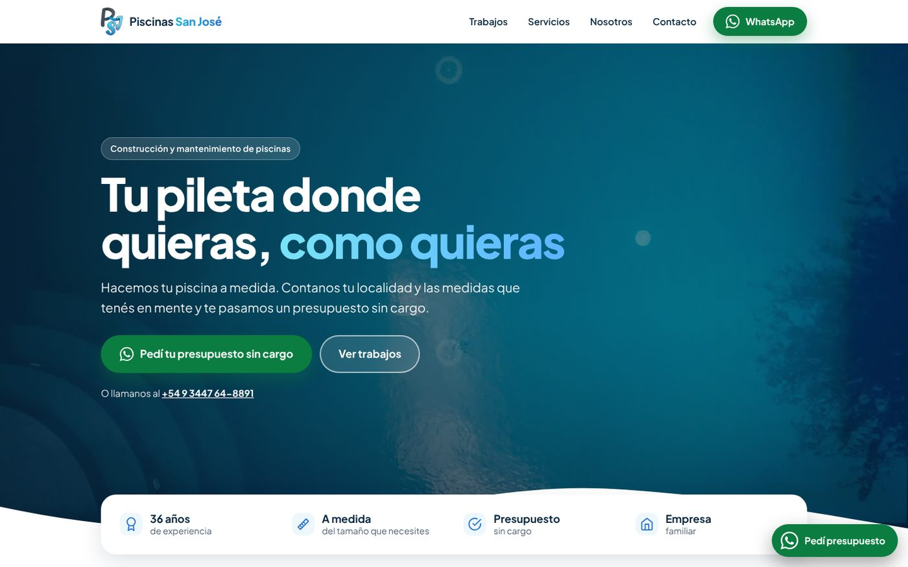
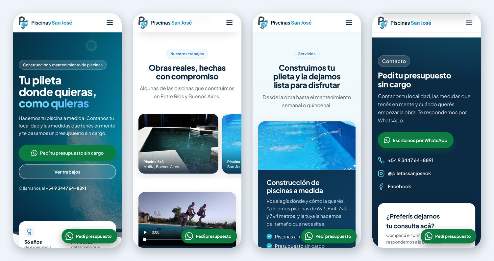
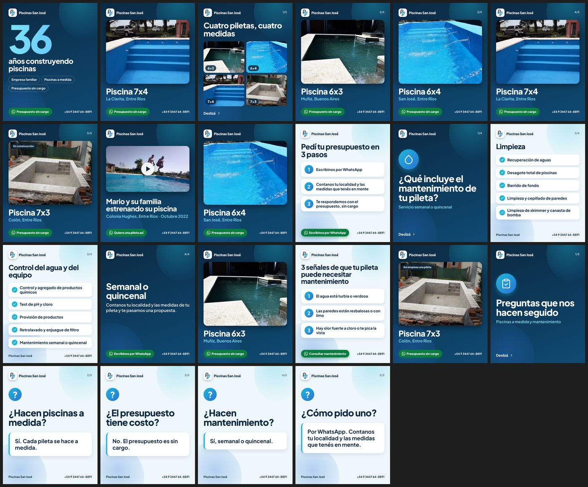

<h1 align="center">Piscinas San José</h1>

<p align="center">
  Sitio web de una empresa familiar de construcción y mantenimiento de piscinas.<br>
  Pensado para una sola cosa: que quien lo visita pida un presupuesto por WhatsApp en pocos toques.
</p>

<p align="center">
  <a href="https://piscinassanjose.netlify.app/"><b>Ver el sitio →</b></a>
  &nbsp;·&nbsp;
  <a href="#english-summary">English summary</a>
</p>

<p align="center">
  
</p>

## De qué se trata

Piscinas San José es la pyme familiar que llevamos con mi papá: construimos piscinas a medida y hacemos mantenimiento en Entre Ríos y Buenos Aires. Armé el sitio para que la gente pueda ver obras reales y pedir un presupuesto sin vueltas.

El link se comparte por WhatsApp y redes sociales, así que lo diseñé **primero para el celular** y con un solo objetivo: que la consulta llegue al WhatsApp de la empresa.

<p align="center">
  
</p>

## Qué resuelve

| Necesidad | Cómo la resolví |
|---|---|
| Que contacten rápido | Botón de WhatsApp en el menú, la portada, cada servicio, el contacto y uno flotante en el celular. Abre el chat con el mensaje ya escrito (cambia según la sección: presupuesto, trabajos o mantenimiento) y le pide la localidad al cliente. |
| Quien prefiere no usar WhatsApp | Formulario que llega por correo ([FormSubmit](https://formsubmit.co/)), con campo trampa contra spam y aviso de confirmación al volver a la página. |
| Mostrar que es real | Galería de obras reales con foto ampliada, dos videos (uno de un cliente y uno de YouTube que recién se carga al tocar) y los datos de la empresa. |
| Que se vea bien al compartirlo | Vista previa con foto y título (Open Graph y Twitter Card, imagen de 1200×630) para WhatsApp y Facebook. |
| Que Google lo entienda | Datos estructurados `HomeAndConstructionBusiness` (JSON-LD), título y descripción propios, `sitemap.xml` y `robots.txt`. |
| Que los links viejos sigan funcionando | `_redirects` con 301 desde las páginas de la versión anterior hacia las secciones nuevas. |

## Resultados medidos

Lighthouse 12, celular, con la limitación de red y CPU simulada (corrida local con compresión):

| Rendimiento | Accesibilidad | Buenas prácticas | SEO |
|:--:|:--:|:--:|:--:|
| **100** | **100** | **100** | **100** |

- Contenido principal visible en ~1,7 s (LCP), sin saltos de diseño (CLS 0) y bloqueo del hilo principal menor a 50 ms (TBT).
- 14 pedidos de red y ~377 KiB en la carga inicial en celular, sin scripts ni librerías de terceros.
- CSS de 20 KB (5,7 KB comprimido) y JavaScript de 4 KB (1,8 KB comprimido).

Para repetir la medición: `npx serve@14 -l 8080` y, en otra terminal, `npx lighthouse http://localhost:8080 --view`.

## Decisiones técnicas

- **HTML, CSS y JavaScript a mano, sin frameworks ni paso de compilación.** Es una página larga de una sola vista y no necesita más; así se publica tal cual está y cualquiera puede modificarla.
- **Tipografía propia.** Plus Jakarta Sans variable en WOFF2 (27 KB), servida desde el mismo sitio y precargada, sin pedirle nada a Google Fonts.
- **Imágenes livianas.** WebP, versiones de distinto tamaño con `srcset` para que el celular no baje la foto grande, carga diferida salvo la portada (que se precarga) y medidas declaradas para que nada se mueva al cargar.
- **Accesibilidad.** Enlace «Saltar al contenido», estructura semántica, foco visible, textos alternativos, galería con `<dialog>` que se maneja con teclado y `Esc`, y animaciones que respetan `prefers-reduced-motion`.
- **Mejora progresiva.** Sin JavaScript la página se lee completa y se puede contactar igual (WhatsApp, teléfono y formulario); el script solo agrega el menú del celular, las animaciones de entrada, la galería ampliada, el video de YouTube y el aviso del formulario.
- **Video sin costo de carga.** El video propio usa `preload="none"` con póster y el de YouTube es una «fachada»: el reproductor (`youtube-nocookie`) se inserta recién cuando alguien toca.

## Estructura

```
index.html          Toda la página
css/site.css        Estilos
js/site.js          Menú, galería, video y formulario
img/  fonts/  vid/  Imágenes, tipografía y video
_redirects          Redirecciones desde las URLs viejas
sitemap.xml         Mapa del sitio para buscadores
robots.txt
docs/img/           Capturas de este README
```

## Probarlo en tu compu

No hay nada que instalar:

```bash
git clone https://github.com/LughDio/PreEntrega3-Diotallevi.git
cd PreEntrega3-Diotallevi
python3 -m http.server 8080   # y abrir http://localhost:8080
```

## Publicación

Se publica en [Netlify](https://www.netlify.com/) con deploy continuo desde la rama `main`. Cada Pull Request genera una vista previa propia para revisar los cambios antes de publicarlos.

## Más allá del sitio

Para acompañar la página armé un kit de publicaciones para Instagram y Facebook con la misma identidad visual: 22 piezas con un calendario de 30 días, portadas de historias destacadas, foto de perfil y un cartel con QR que abre el chat de WhatsApp.

<p align="center">
  
</p>

## Historial

La primera versión (varias páginas, Sass y un servidor Express) quedó en el historial de Git; después la rehice desde cero como esta página única.

---

## English summary

One-page, mobile-first website for a family-run swimming pool construction business in Argentina. The goal is a single action: get visitors to request a quote on WhatsApp.

- Plain HTML, CSS and JavaScript: no framework, no build step.
- WhatsApp click-to-chat links with a prefilled message that changes by section, plus an email form as a fallback.
- Structured data (`HomeAndConstructionBusiness`), Open Graph / Twitter Card previews, sitemap and redirects from the old URLs.
- Lighthouse (mobile, simulated throttling): **100 / 100 / 100 / 100**, LCP ≈ 1.7 s, CLS 0, 14 network requests (~377 KiB) on first load and no third-party scripts.
- Self-hosted font, responsive WebP images, lazy video (YouTube facade), keyboard-friendly gallery and reduced-motion support.
- Hosted on Netlify with continuous deployment from `main` and a Deploy Preview for every Pull Request.
